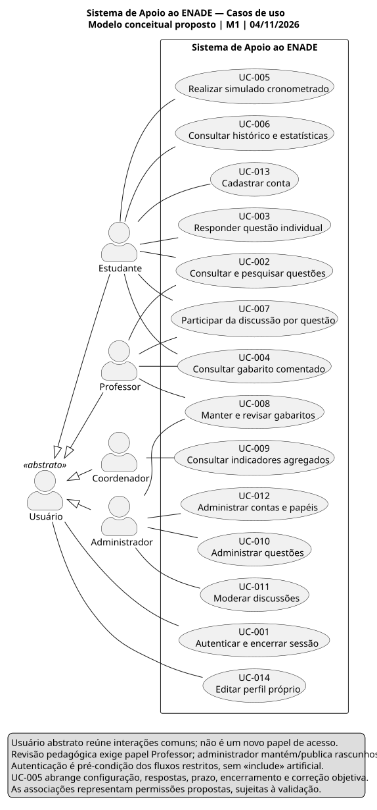
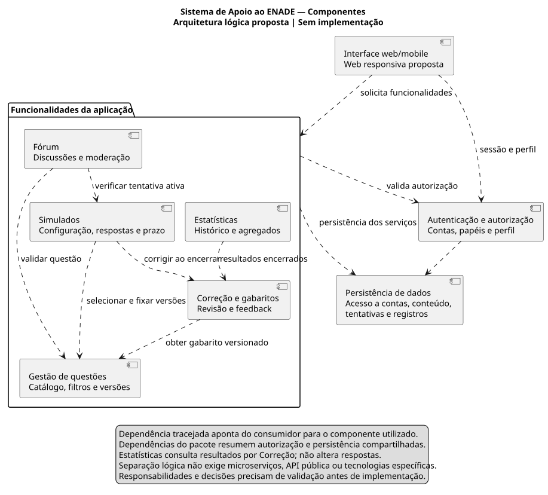
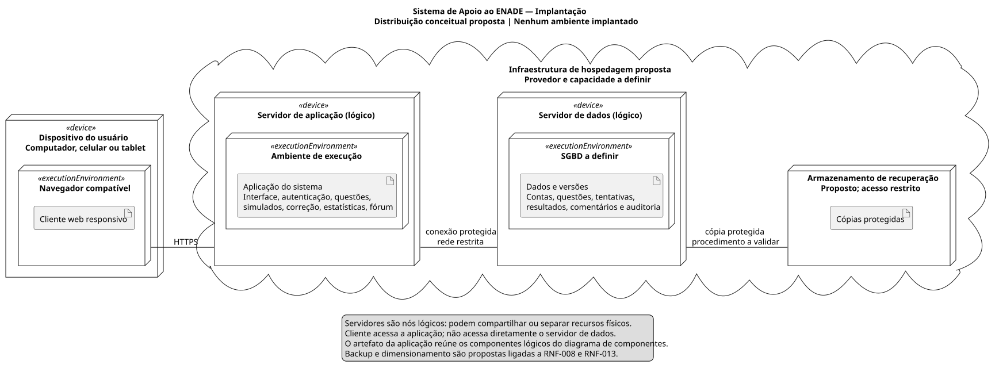

# Sistema de Apoio ao ENADE

Documentação da **Atividade 1 — Trabalho P1**, da disciplina **Requisitos e Modelagem de Sistemas**, **Universidade de Fortaleza (Unifor)**. O projeto especifica uma solução web/mobile para preparação de estudantes, com elicitação de requisitos e modelagem UML inicial.

**Sprint 1 / M1:** 19/10/2026 a 01/11/2026 · **Versão documental:** 2.0, preparada em 04/11/2026 · **Valor:** 2,0 pontos.

**Estado real:** documentação publicada na branch `docs/m1-requirements-and-uml`; não há aplicação implementada. M1 e 13 issues foram criados, e o convite do professor foi enviado, com aceite pendente. Entrevistas reais, validação com stakeholders e identificação completa do grupo permanecem pendentes. O prazo histórico não foi alterado. Consulte o [relatório da Sprint](docs/07-sprint/relatorio-sprint1.md), o [estado do GitHub](evidencias/github/README.md) e o [PDF complementar](entregaveis/Trabalho_P1_ENADE_M1_v2.pdf).

## Problema e objetivo

O material da disciplina descreve dificuldades de preparação associadas a materiais dispersos, falta de simulados organizados e feedback insuficiente. O objetivo é especificar um ambiente que permita localizar questões relevantes, praticar com tempo definido e compreender o desempenho, antes de qualquer desenvolvimento. A [visão](docs/01-visao/documento-visao.md) detalha hipóteses, limites, riscos e benefícios esperados.

## Funcionalidades e público

Os seis módulos do material-base são **Banco de Questões, Simulados Cronometrados, Gabarito Comentado, Estatísticas de Desempenho, Fórum de Discussão e Autenticação**. A administração de conteúdo e usuários integra o escopo do pedido. Gestão de perfil, histórico, correção automática objetiva, moderação e indicadores agregados são detalhamentos propostos, sujeitos a validação.

O público reúne estudantes de graduação, professores, coordenadores e administradores. Equipe de análise e instituição participam como stakeholders complementares. Nenhuma pessoa foi registrada como entrevistada ou aprovadora sem evidência.

## Oito entregáveis obrigatórios

| Nº | Entregável | Acesso direto | Situação |
|---|---|---|---|
| 1 | Documento de Visão | [Visão completa](docs/01-visao/documento-visao.md) | Redigido; validar |
| 2 | Identificação de Stakeholders | [Perfis e matriz](docs/02-stakeholders/identificacao-stakeholders.md) | Identificação documental; representantes pendentes |
| 3 | Entrevistas: roteiro e resultados | [Roteiro](docs/03-elicitacao/roteiro-entrevistas.md) · [Resultados](docs/03-elicitacao/resultados-entrevistas.md) | Instrumentos prontos; coleta real pendente |
| 4 | Especificação de Requisitos | [20 RF](docs/04-requisitos/requisitos-funcionais.md) · [14 RNF](docs/04-requisitos/requisitos-nao-funcionais.md) | Propostas verificáveis; não aprovadas |
| 5 | Regras de Negócio | [12 RN](docs/04-requisitos/regras-negocio.md) | Propostas; validar |
| 6 | Backlog Priorizado | [17 histórias](docs/05-backlog/backlog-priorizado.md) · [CSV](docs/05-backlog/backlog-priorizado.csv) | MoSCoW proposto para produto futuro |
| 7 | Modelagem UML | [Três modelos com fontes e imagens](docs/06-modelagem-uml/README.md) | Diagramas conceituais |
| 8 | Repositório e acesso do professor | [Evidências GitHub](evidencias/github/README.md) · [Checklist](docs/08-entrega/checklist-entrega.md) | Verificar registro real de publicação e colaboração |

## Estrutura e índice completo

```text
projeto-enade/
├── README.md
├── .gitignore / .gitattributes
├── .github/                 Modelos de issues e pull request
├── docs/
│   ├── 01-visao/
│   ├── 02-stakeholders/
│   ├── 03-elicitacao/
│   ├── 04-requisitos/
│   ├── 05-backlog/
│   ├── 06-modelagem-uml/     Casos de uso, componentes e implantação
│   ├── 07-sprint/            Planejamento e textos das 13 issues
│   └── 08-entrega/
├── evidencias/              Instrumentos e registros reais
├── referencias/             Fontes, originais preservados e manifesto
├── ferramentas/             Verificação e renderização documental
└── entregaveis/             Relatório complementar e orientações
```

O nome local e o remoto `projeto-enade` foram preservados porque já existiam; não foi criado um segundo repositório `sistema-apoio-enade`.

- Elicitação: [planejamento](docs/03-elicitacao/planejamento-elicitacao.md), [roteiros](docs/03-elicitacao/roteiro-entrevistas.md), [questionário](docs/03-elicitacao/questionario.md), [resultados e ficha](docs/03-elicitacao/resultados-entrevistas.md), [validação](docs/03-elicitacao/validacao-requisitos.md).
- Requisitos e backlog: [RF](docs/04-requisitos/requisitos-funcionais.md), [RNF](docs/04-requisitos/requisitos-nao-funcionais.md), [RN](docs/04-requisitos/regras-negocio.md), [matriz de rastreabilidade](docs/04-requisitos/matriz-rastreabilidade.md), [histórias](docs/05-backlog/backlog-priorizado.md), [definição de pronto](docs/05-backlog/definicao-pronto.md).
- UML: [casos de uso](docs/06-modelagem-uml/casos-de-uso/README.md), [componentes](docs/06-modelagem-uml/componentes/README.md), [implantação](docs/06-modelagem-uml/implantacao/README.md), [como renderizar](docs/06-modelagem-uml/README.md).
- Sprint e entrega: [planejamento M1](docs/07-sprint/planejamento-m1.md), [relatório](docs/07-sprint/relatorio-sprint1.md), [índice das issues](docs/07-sprint/issues/README.md), [checklist](docs/08-entrega/checklist-entrega.md), [instruções AVA](docs/08-entrega/instrucoes-ava.md), [validação técnica](docs/08-entrega/validacao-tecnica.md), [entregáveis complementares](entregaveis/README.md).
- Evidências e fontes: [entrevistas](evidencias/entrevistas/README.md), [modelo de registro](evidencias/entrevistas/modelo-registro.csv), [GitHub e professor](evidencias/github/README.md), [catálogo de fontes](referencias/README.md), [manifesto dos originais](referencias/manifesto-originais.json).
- Colaboração: [modelo de tarefa](.github/ISSUE_TEMPLATE/tarefa-documental.md), [modelo de validação](.github/ISSUE_TEMPLATE/validacao-requisito.md), [modelo de PR](.github/PULL_REQUEST_TEMPLATE.md).

## Pré-visualização UML

### Casos de uso



### Componentes



### Implantação



Abra o SVG individual para ampliar. Arquivos PlantUML e PNG estão disponíveis no índice de cada modelo. Os diagramas representam propostas, não software ou infraestrutura em operação.

## Elicitação e priorização

A análise documental utilizou a apresentação original e o pacote anterior. Foram preparados 35 questionamentos de entrevista distribuídos entre quatro perfis e um questionário com 16 perguntas. Entrevistas, aplicação do questionário, análise de similares e oficina de validação ainda dependem de execução real. Necessidades inferidas são hipóteses rastreadas; não há percentuais de pesquisa inventados.

MoSCoW prioriza consulta, simulado e feedback, com suas dependências de conteúdo e acesso. Fórum, histórico e agregados vêm depois da jornada principal; busca textual e perfil são opcionais no planejamento inicial. A **M1 é documental**: FUT-01/02/03 são agrupamentos futuros sem compromisso de execução.

## Como avaliar

1. Começar pela visão e pelas fontes para distinguir problema documentado e inferências.
2. Conferir instrumentos e ausência explícita de resultados empíricos ainda não fornecidos.
3. Selecionar um RF na matriz e seguir necessidade, stakeholder, regra, história e caso de uso.
4. Verificar critérios mensuráveis dos RNF e modelos conceituais.
5. Consultar checklist, relatório técnico e evidências reais do GitHub.

Os critérios da P1 são visão (0,5), elicitação (0,5), requisitos (0,5) e UML (0,5). O material geral da disciplina inclui outras entregas e pesos; o recorte da P1 segue o pedido específico, conforme [divergências registradas](referencias/README.md).

## Integrantes e identificação

| Campo | Situação |
|---|---|
| Integrantes do grupo | PENDENTE — informar nomes reais |
| Matrículas exigidas no AVA | PENDENTE — preencher no ambiente de entrega apropriado |
| Professor avaliador | Conta informada: `marcelobezerra-dotcom`; nome completo não fornecido |
| Repositório real | [JoaoRoberto1/projeto-enade](https://github.com/JoaoRoberto1/projeto-enade) |
| Branch de trabalho | `docs/m1-requirements-and-uml` |

A conta proprietária do repositório não foi presumida como lista completa de integrantes. Nenhuma licença foi adicionada sem autorização.

## Verificação documental

```powershell
python ferramentas/validar-documentacao.py
./ferramentas/renderizar-diagramas.ps1 -PlantUmlJar 'C:\caminho\plantuml-java8-1.2026.9.jar'
```

Os scripts tratam apenas dos artefatos acadêmicos. Não há frontend, backend, API ou banco executável.

## Referências

Fonte primária: apresentação *Projeto de Extensão — ENADE: Engenharia de Requisitos Aplicada ao Contexto Educacional*, 10 páginas, autoria/data não informadas, preservada no repositório. Consulte [fontes e originais](referencias/README.md), [Inep — Enade](https://www.gov.br/inep/pt-br/areas-de-atuacao/avaliacao-e-exames-educacionais/enade) e [W3C — WCAG 2.2](https://www.w3.org/TR/WCAG22/). Não se afirma aprovação institucional, conformidade de produto ou melhoria de desempenho já demonstrada.
