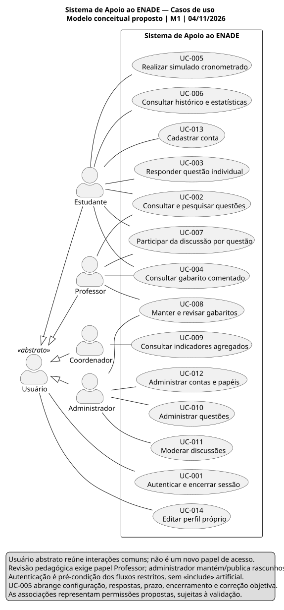

# Casos de uso

[Fonte PlantUML](casos-de-uso.puml) · [PNG](casos-de-uso.png) · [Instruções de renderização](../README.md)

O limite do sistema contém 14 casos de uso. Estudante, Professor, Coordenador e Administrador são os quatro papéis concretos. O ator abstrato Usuário representa apenas o comportamento comum de autenticação e edição do próprio perfil. Cadastro é associado ao estudante ainda sem conta; as demais ações exigem sessão e autorização conforme sua especificação.

| Caso | Objetivo | Ator concreto | RF associados |
|---|---|---|---|
| UC-001 | Autenticar e encerrar sessão | Todos | RF-002 |
| UC-002 | Consultar/pesquisar questões e origem | Estudante, Professor | RF-003, RF-017, RF-018 |
| UC-003 | Responder questão individual | Estudante | RF-004 |
| UC-004 | Consultar gabarito comentado e proveniência | Estudante; Professor no contexto autorizado | RF-005, RF-018 |
| UC-005 | Configurar, executar, responder, encerrar e corrigir simulado | Estudante | RF-006, RF-007, RF-008, RF-020 |
| UC-006 | Consultar histórico e estatísticas pessoais | Estudante | RF-009, RF-010 |
| UC-007 | Ler e publicar discussão por questão | Estudante, Professor | RF-011 |
| UC-008 | Manter rascunho e revisar gabarito | Administrador mantém; Professor aprova revisão | RF-014 |
| UC-009 | Consultar indicadores agregados autorizados | Coordenador | RF-015 |
| UC-010 | Administrar questões e versões | Administrador | RF-013 |
| UC-011 | Moderar discussões com justificativa | Administrador | RF-012 |
| UC-012 | Administrar contas e papéis | Administrador | RF-016 |
| UC-013 | Cadastrar conta de estudante | Estudante | RF-001 |
| UC-014 | Editar dados permitidos do próprio perfil | Todos | RF-019 |

## Decisões de modelagem

Não se usou `include` para autenticação: uma sessão válida é pré-condição, não uma autenticação repetida obrigatoriamente dentro de cada fluxo. As etapas de simulado estão detalhadas em RF-006/007/008/020, dentro de UC-005. Não foi identificado comportamento opcional que justificasse `extend` nesta abstração.

O modelo não concede ao professor acesso ao desempenho individual de alunos. UC-009 só funciona após aprovação de escopo e supressão de grupos pequenos. O administrador não recebe automaticamente permissão de aprovação pedagógica; deve acumular formalmente o papel Professor para essa ação. A edição limitada de perfil é proposta e não altera papéis.

## Cenário principal de UC-005

Estudante autenticado configura filtros, quantidade e duração; sistema valida a disponibilidade; estudante confirma início; sistema fixa versões e prazo; respostas são confirmadas até o limite; conclusão manual confirmada ou expiração encerra a tentativa; sistema corrige uma única vez e libera resultado e gabarito. Exceções: configuração inviável, alternativa inválida, acesso de outro titular, perda de rede e envio recebido no prazo ou depois são tratados conforme RF/RN. A indisponibilidade não autoriza registrar uma resposta que não chegou.

Os fluxos de todos os casos podem ser lidos nos [RF](../../04-requisitos/requisitos-funcionais.md); as ligações estão na [matriz](../../04-requisitos/matriz-rastreabilidade.md).
