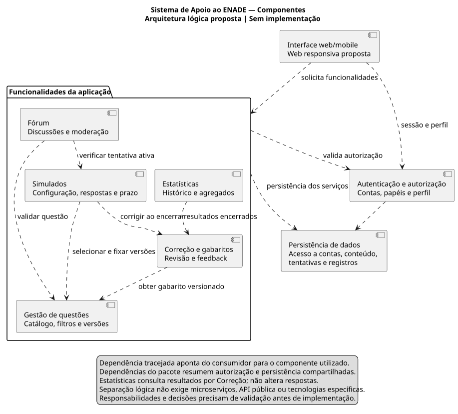

# Diagrama de componentes

[Fonte PlantUML](componentes.puml) · [PNG](componentes.png) · [Renderização](../README.md)

Dependências tracejadas apontam do consumidor para o componente utilizado. O modelo separa responsabilidades lógicas; não define microserviços, endpoints, linguagem, framework ou banco executável.

| Componente | Responsabilidade | Requisitos |
|---|---|---|
| Interface web/mobile | Apresentar fluxos com adaptação a computador/celular e acessibilidade | RF de interação; RNF-001, RNF-006, RNF-011 |
| Autenticação e autorização | Sessão, cadastro, papéis, perfil e decisão de acesso | RF-001, RF-002, RF-016, RF-019; RN-012 |
| Gestão de questões | Catálogo, filtros, busca, origem, versões e publicação | RF-003, RF-013, RF-017, RF-018 |
| Simulados | Prática individual, seleção, respostas, prazo e encerramento | RF-004, RF-006, RF-007, RF-020; RNF-009 |
| Correção e gabaritos | Revisão de comentários, consulta de feedback e apuração de resultados | RF-005, RF-008, RF-014 |
| Estatísticas | Histórico e indicadores pessoais/agregados a partir de resultados encerrados | RF-009, RF-010, RF-015 |
| Fórum | Discussões e moderação, respeitando bloqueio durante tentativa | RF-011, RF-012; RN-006, RN-008 |
| Persistência de dados | Armazenar contas, versões, tentativas, resultados, comentários e registros administrativos | RNF-007, RNF-008, RNF-014 |

Questões, Simulados, Correção, Estatísticas e Fórum consultam Autenticação para autorização. Simulados usa Questões para fixar versões e Correção ao encerrar. Estatísticas recebe resultados por Correção; o acesso ao histórico passa por esse serviço, sem introduzir dependência reversa. Fórum consulta Simulados para impedir a discussão das questões durante uma tentativa ativa. Correção consulta a versão da questão, e não uma cópia mutável do gabarito corrente.

As dependências do pacote Funcionalidades da aplicação resumem as chamadas dos seus componentes para autorização e persistência. Estatísticas delega leitura dos resultados a Correção, enquanto os outros componentes persistem seus próprios dados. A interface solicita as funcionalidades contidas no pacote; essa agregação evita repetir conexões na figura sem omitir as responsabilidades da tabela.

O diagrama reduz detalhes internos de persistência para manter legibilidade. A separação lógica é uma hipótese arquitetural ligada a RNF-010; não comprova manutenibilidade de software ainda inexistente.
