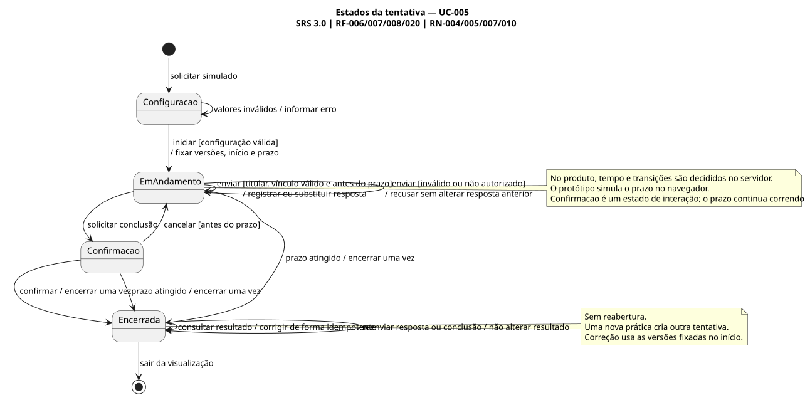

# Estados da tentativa — P2

[Fonte PlantUML](estados-simulado.puml) · [PNG](estados-simulado.png) · [SRS](../../09-srs/SRS.md)

Mostra configuração, execução, confirmação e encerramento, com tempo continuando durante a confirmação. Não existe reabertura; outra prática cria outra tentativa.

Rastreabilidade: UC-005, RF-006/007/008/020, RN-004/005/007/010/012. As condições de cada fluxo constam no SRS; o prazo autoritativo da aplicação-alvo permanece diferente da simulação local.
