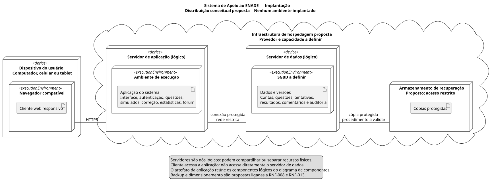

# Diagrama de implantação

[Fonte PlantUML](implantacao.puml) · [PNG](implantacao.png) · [Renderização](../README.md)

Este modelo é uma **proposta**, sem servidores contratados, aplicação instalada, banco criado ou serviço publicado.

O dispositivo do usuário hospeda um navegador, ambiente de execução do cliente web responsivo. O cliente se comunica por HTTPS com o servidor lógico de aplicação. Nesse servidor, um artefato da aplicação reúne os componentes lógicos de autenticação, questões, simulados, correção, estatísticas e fórum. O servidor de dados hospeda um SGBD ainda indefinido e o artefato de dados versionados. O navegador não se conecta diretamente a esse servidor.

| Elemento | Decisão proposta | Requisitos relacionados |
|---|---|---|
| Navegador / cliente | Acesso por computador, celular ou tablet; aplicativo nativo não obrigatório | RNF-001, RNF-006, RNF-011 |
| Servidor de aplicação | Executar regras e autorização; relógio confiável para tentativas | RNF-004, RNF-009, RNF-010 |
| Servidor de dados | Acesso restrito à aplicação e preservação de versões | RNF-005, RNF-012, RNF-014 |
| Armazenamento de recuperação | Cópias protegidas e teste futuro de restauração | RNF-008 |
| Hospedagem | Provedor, capacidade e divisão física a definir | RNF-002, RNF-003, RNF-013 |

As ligações entre nós indicam canais de comunicação, sem fixar produtos. Conexão da aplicação ao SGBD e transferência de cópias precisam de proteção adequada, a definir no projeto técnico. Separação em nós lógicos não exige máquinas físicas distintas. Metas de desempenho, escala e disponibilidade continuam propostas, sem evidência de atendimento.
