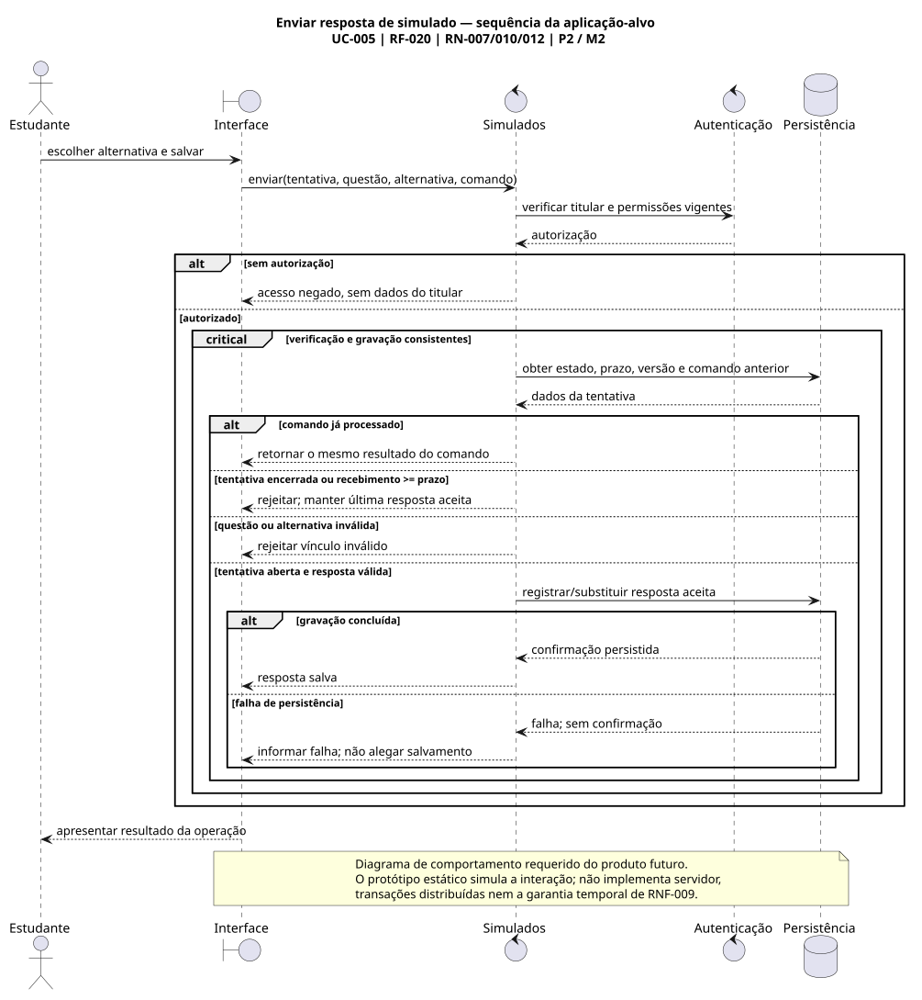

# Sequência de envio de resposta — P2

[Fonte PlantUML](sequencia-resposta.puml) · [PNG](sequencia-resposta.png) · [SRS](../../09-srs/SRS.md)

Especifica autorização, vínculo, prazo, idempotência e confirmação após persistência no produto futuro. O protótipo não implementa servidor nem transação distribuída.

Rastreabilidade: UC-005, RF-006/007/008/020, RN-004/005/007/010/012. As condições de cada fluxo constam no SRS; o prazo autoritativo da aplicação-alvo permanece diferente da simulação local.
